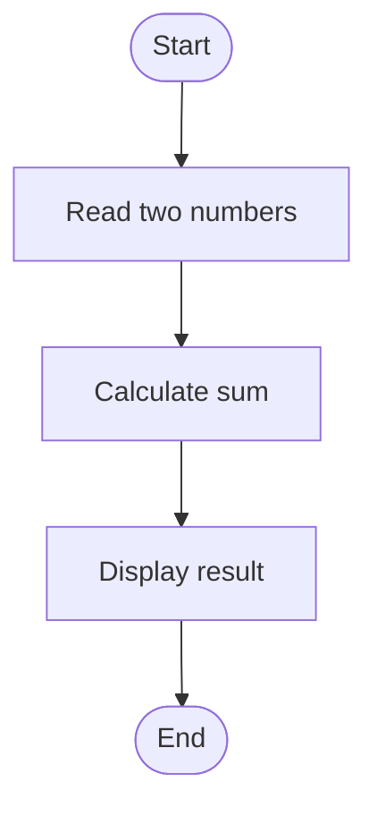

# Drawing and Graph Plotting Examples

This section contains a simple flowchart and plotting examples using GNUPlot and Python Matplotlib.

## Flowchart

The following Mermaid flowchart demonstrates a simple calculation process:



## GNUPlot

Run from this directory:

```bash
gnuplot sine.gp
```

The script creates `sine.png` in the current directory.

## Python Matplotlib

Install Matplotlib if required:

```bash
python -m pip install matplotlib
```

Run:

```bash
python plots.py
```

The script saves line, bar and scatter plot images in the current directory.
