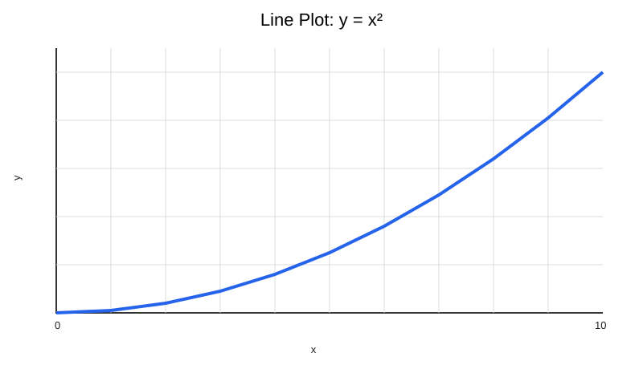
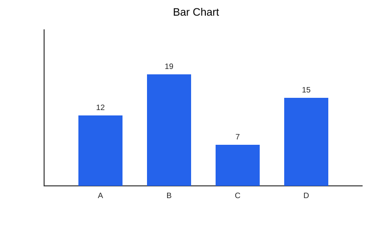
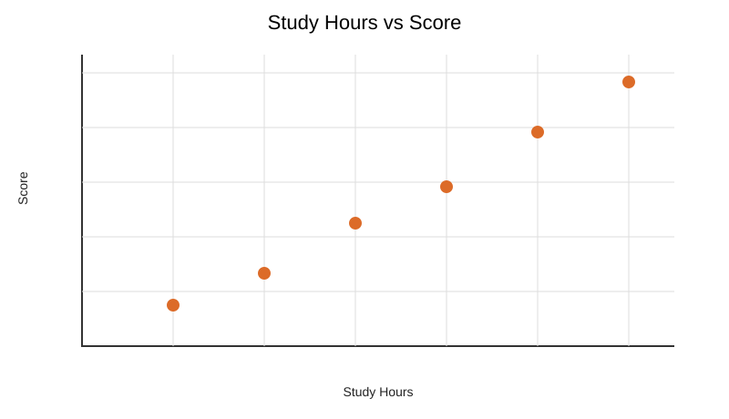

# Drawing and Graph Plotting Examples

This section contains a simple flowchart and plotting examples using GNUPlot and Python Matplotlib.

## Flowchart

The following Mermaid flowchart demonstrates a simple calculation process:


## GNUPlot

Run from this directory:

```bash
gnuplot sine.gp
```

The script creates `sine.png` in the current directory. A sample SVG preview is included in [outputs](outputs/sine-cosine.svg).

## Python Matplotlib

Install Matplotlib if required:

```bash
python -m pip install matplotlib
```

Run:

```bash
python plots.py
```

The script saves `line_plot.png`, `bar_chart.png` and `scatter_plot.png` in the current directory. Sample SVG previews are included below.

### Sample outputs






